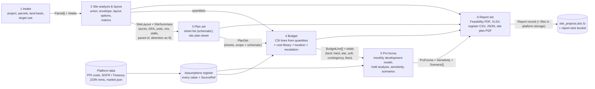

# Integration plan: one feasibility platform

**Status:** Accepted (autonomous build; decisions logged in `docs/DECISIONS.md`)
**Date:** 2026-10-24
**Branch:** `experimental` in fs-real-estate-intelligence
**Inputs:** `docs/AUDIT.md` (Parts A–C are cited below as A§, B§, C§)

This plan follows the ADR format: context, the decision, the options considered, trade-offs, consequences and action items. The action items are the ordered build phases (§7).

---

## 1. Context

Three codebases each do part of a development feasibility study:

- **fs-real-estate-intelligence (the platform):**
  - parcels and site layouts (the best layout engine of the three);
  - a monthly development pro forma;
  - a schematic plan set;
  - public-data market and risk reports;
  - Supabase, Chromium PDF, and Claude/OpenAI clients.
- **fs-budgeting-suite:**
  - production-grade budget roll-up math;
  - a fixture-proven before-tax investment engine;
  - cost data from one project only.
- **fs-cre-report-runner:**
  - a deterministic screening yield and buildable envelope;
  - a metes-and-bounds survey parser;
  - report structures (fact and assumption register, risk analysis);
  - LLM output guards;
  - a production pro forma and market research that are mostly LLM-written.

No single repo takes one project from intake to a full, traceable report set. The source repos are bound to their own infrastructure (Azure SQL/Entra; Vercel Blob, monday.com and Zapier), which the platform must not touch (`CLAUDE.md`, Infrastructure isolation).

**Constraints**
- Everything runs inside the platform: its Vercel functions, its Supabase, its PDF pipeline, its keys.
- The platform stack stays vanilla ES modules: no framework, no bundler, and browser, server and tests share `lib/*.mjs`.
- The app must work after every build phase, and existing tests must keep passing.
- Tests never touch real infrastructure.
- Every number shown to a user must trace to a source or a labelled assumption.

## 2. Best version of each area (with evidence)

| Area | Winner | Evidence | Also brought in |
|---|---|---|---|
| (a) Budgets / cost estimating | **fs-budgeting-suite math** (`api/shared/budget-calc.js`, CSI schedule, guard rails, impact fees) | Server-authoritative roll-up with browser/server parity tests. Closed-form circular fee: `project = (base+fixed)/max(1−rate,0.05)` (B§6.1). Reproduces the "Budget For Projects 3.0 MAIN" workbook in `test/calculations.test.js` (14 tests). 304/304 tests pass (B§4) | The platform's plan-quantity site costs (`lib/proforma.mjs:65-74`, A§4a). They are the only budget inputs driven by the actual layout. The suite's cost **data** is demo-grade (B§5a) and is carried with honest labels, not as fact |
| (b) Pro forma | **The platform's monthly development model** (`lib/proforma.mjs` `runM`) for land → construction → lease-up → refinance → sale, **plus the budgeting suite's before-tax engine** (`api/shared/investment/*`) for the stabilized hold analysis | The platform's model is the only one with construction draws, capitalized interest, lease-up and refinance sizing (A§4b, A§6). The TestFit one-pager is verified to the dollar (`test/proforma.mjs`). The suite's engine matches 5 reference deals within ±$1.5 / 0.006 pp (B§4, B§5b), but it has no construction period. The report runner's IRR is unused and its production pro forma is LLM arithmetic (C§5b) | From the report runner: the break-even price/rent and target-margin math and the sensitivity grid idea (`calc.js:233-246`, C§6), re-implemented on the shared finance primitives |
| (c) Site layout | **The platform's** (`lib/siteplan.mjs`, `lib/sitelayout.mjs`) | Drive-network-first engine, checks, parking/coverage/FAR, stormwater, ADA, Waller guardrails, DXF. Runs headless in Node (the tests call `layoutOptions`) (A§4c) | From the report runner: the **buildable envelope** (exact distance transform, `lib/v2/site/envelope.js`, 100% covered) and the **survey metes-and-bounds parser** (`api/_survey.js`). The survey parser is fixed to use the WGS84 plane (removes the 0.33% drift) and gets the tests it lacked (C§5c) |
| (d) Plan sets | **The platform's** (`lib/planset.mjs`, `lib/sheets/*`) | The only plan set in the three repos: a 24×36 schematic set on the FS title block (A§4d). The report runner has 4 letter sheets; the budgeting suite has none | Nothing |
| (e) CRE market research and reports | **The platform's data-backed reports** (`lib/reports/*`, `data/area.json`, `data/markets.json`) and report kit | Every figure comes from a named public source with a refresh date (A§4e). The report runner's market research is LLM web search with no data layer (C§5e) | From the report runner: the **document set structure** (Fact & Assumption Register, Risk Analysis, executive summary) and the **LLM-output guards** (`lib/v2/validation/index.js`: chatter, placeholder, strategy gate). Any AI narrative is optional, and it never supplies a number |

## 3. Target system flow

Each step is a pure function of the project document. The browser, the API and the tests all run the same code.



**What moves between the steps** (types in §4.3)

| From → to | Data |
|---|---|
| Intake → Site | `Parcel[]` (geometry, acres, owner, address, ZIP, county, appraised land and total value, source), `Intake` (target use, land price and its basis, jurisdiction) |
| Site → Plan set, Budget | The chosen `SiteLayout` (the existing plan option: ring, elements, program) and its `SiteSummary`: acres, buildable sf (envelope), GFA by use, units and mix, stalls, paved sf, detention/vault ac-ft, amenities, coverage, FAR. These come from `metrics()` / `metricsOf()` |
| Plan set → Budget, Report | `PlanSet`: sheet list (number, title, discipline) and scope "schematic design". The plan set feeds the budget only through the same layout quantities; there is no take-off from drawings (see §6) |
| Budget → Pro forma | `BudgetLine[]`, rolled up to land, hard (with GC fee), site, FF&E/TI/LC, soft, contingency and developer fee. The pro forma adds financing (construction interest, loan fees) to reach total development cost |
| Assumptions → Budget, Pro forma | `Assumption[]` (value, unit, group, `SourceRef`, range) with the user's overrides merged in. Scenarios are named override sets |
| Pro forma → Report | Monthly and annual cash flows, returns (unlevered/levered IRR, NPV, yield on cost, DSCR, CoC, multiple, profit, margin), the hold analysis, sensitivity tables, scenario comparison |
| Report → storage | A `Report` record (inputs hash, created, files) on the project document. Files go to the platform's Storage bucket when configured, and otherwise download directly |

## 4. Architecture

### 4.1 Decision: how source code comes in

**Options considered**

#### Option A: Port the chosen modules into the platform as ES modules, with their tests and fixtures (chosen)
| Dimension | Assessment |
|---|---|
| Complexity | Medium: CommonJS → ESM is mechanical for the pure modules (B§9 and C§9 rate them "Low") |
| Cost | No new services or infrastructure |
| Scalability | Same as the platform: pure functions run in the browser, Vercel functions and Node |
| Team familiarity | High: the platform's own style (`lib/*.mjs` + plain node tests) |

**Pros:**
- One codebase and one data model.
- Shared finance primitives, so no duplicate math.
- Fixtures prove the port reproduces the originals.
- No runtime link to the source infrastructure.

**Cons:**
- No automatic pick-up of later fixes in the source repos; they must be ported by hand.

#### Option B: Vendor the source repos as git submodules / npm packages
| Dimension | Assessment |
|---|---|
| Complexity | Medium–High: CommonJS in an ESM app, Azure Functions v3 handlers, mssql/Blob imports pulled in |
| Cost | Drags in source-infra code paths that the isolation grep would flag |
| Scalability | Same |
| Team familiarity | Low |

**Pros:**
- Tracks upstream.

**Cons:**
- Two data models.
- Infrastructure references come along.
- Dead code (the report runner's root files) and fixture-bound renderers ship too.

#### Option C: Call the source deployments as services
Rejected outright: it breaks the infrastructure-isolation rules.

#### Option D: Rewrite from scratch
**Pros:**
- A clean design.

**Cons:**
- Throws away tested, fixture-proven math (304 + 175 tests).
- High risk of new errors.

**Trade-off analysis.** Option A keeps the proven arithmetic, which is where the value is, and drops the source repos' persistence and orchestration. The source repos are snapshots of active work, so later improvements there won't flow in by themselves. That cost is accepted and recorded in `docs/DECISIONS.md`, and the provenance header on each ported file names the source repo, branch and commit, so a later diff is easy.

**Consequences**
- *Easier:* one test suite, one schema, end-to-end runs in Node, and every number goes through the same assumptions register.
- *Harder:* keeping parity with upstream fixes, which is now a manual port.
- *To revisit:* replacing the single-project cost library with a licensed cost database (§5.1).

### 4.2 Folder structure (new and changed)

```
lib/feasibility/            # the integrated core: no DOM, no network; browser + API + tests share it
  model.mjs                 # THE shared schema: types (JSDoc), factories, validation, SourceRef helpers
  finance.mjs               # primitives: pmt, balance, irr, npv, xirr-free annual/monthly helpers, dscr, yield on cost, break-evens
  costlib.mjs               # cost library: CSI-coded rates, each with source/region/as-of/confidence
  escalation.mjs            # cost escalation from the PPI series in data/markets.json + forward escalation
  budget.mjs                # budget-from-layout (BudgetLine[]), roll-up (budgeting-suite math), CSI schedule
  guardrails.mjs            # budget guard rails (ported)
  impactfees.mjs            # impact & tap fee calculator + the City of Waller schedule (ported)
  investment/*.mjs          # the before-tax hold engine (ported from the budgeting suite, uses finance.mjs)
  proforma.mjs              # development pro forma adapter: budget → lib/proforma.mjs, NPV, hold analysis
  sensitivity.mjs           # tornado + two-way grids + break-evens
  assumptions.mjs           # the assumptions register: defaults with sources, overrides, scenarios
  envelope.mjs              # buildable envelope (ported from the report runner)
  survey.mjs                # metes-and-bounds → parcel polygon (ported, fixed, tested)
  register.mjs              # fact & assumption register, risk register (deterministic rules)
  guards.mjs                # LLM narrative guards (ported validation)
  pipeline.mjs              # intake → site → plans → budget → pro forma → report data, one call per step
  xlsx.mjs                  # workbook export (budget, pro forma, register)
lib/reports/feasibility.mjs # the feasibility report set (HTML → PDF through lib/pdf.mjs)
api/feasibility.js          # compute / report endpoints (PDF, XLSX, JSON, CSV); optional AI narrative
src/workspace.js, .css      # the project workspace UI (stepper, summary, steps, scenarios)
scripts/dev.mjs             # local dev server: public/ + /api/* shim (no Vercel login needed)
scripts/sample-run.mjs      # one sample project end to end, offline → docs/sample-output/
test/fz-*.mjs               # tests for everything above
supabase/migrations/2026102600000*_report_sets.sql  # private bucket for report files (owner applies)
.env.example                # every env var the platform reads, documented
```

The changes to existing files are small and additive:
- `lib/proforma.mjs`: accepts a budget from the budget module, uses the shared finance primitives, and gets three fixes (§5.4).
- `lib/project.mjs`: a Workspace tab.
- `src/siteplan.js`: mounts the workspace and keeps the parcel's address and ZIP at intake.
- `build.mjs`: copies `lib/feasibility/` into `public/`.
- `vercel.json`: config for the new function.
- `package.json`: scripts.

### 4.3 The one shared data model

Defined once in `lib/feasibility/model.mjs`. The project stays one JSON document in the platform's `site_projects` table (A§5), so syncing, offline use and the team passcode keep working. Feasibility state lives under `project.fz`. Computed results are **not** stored: they are recomputed from inputs, which keeps them deterministic. A report snapshot records the hash of its inputs.

```
SourceRef   { kind: 'data'|'library'|'plan'|'house'|'user'|'derived', label, ref?, asOf?, confidence: 'high'|'medium'|'low' }
Project     { id, name, status, client, notes, parcels: Parcel[], plans: SiteLayout[], fz: Feasibility, updated, by }
Parcel      { key, label, owner, propId, apn?, address?, city?, zip?, county?, acres, landValue?, marketValue?, geometry (GeoJSON), source: SourceRef }
Feasibility { schema: 1, intake: Intake, optionId?, overrides: { [assumptionKey]: value }, budgetEdits: { [lineId]: { rate?, qty?, off? } },
              scenarios: Scenario[], activeScenario?, reports: Report[] }
Intake      { address?, city?, county?, state: 'TX', zip?, jurisdiction?, targetUse?, landPrice?, landBasis: 'asking'|'appraised-land'|'appraised-total'|'house' }
SiteLayout  = the existing plan option (ring, elements, program, params, stages…, lib/siteplan.mjs)
SiteSummary { acres, siteSf, buildableSf, envelopeRatio, gfa, byUse: { use: { gsf, nrsf, units } }, units, mix[], stalls, required, pavedSf, parkingSf,
              detentionAcFt, vaultAcFt, coverage, far, issues[] }
PlanSet     { optionId, scope: 'schematic', sections[], sheets: [{ number, title, kind }], issued: [{ id, no, when }] }
BudgetLine  { id, group: 'land'|'hard'|'site'|'ffe'|'ti'|'soft'|'contingency'|'fee'|'financing', csi?, division?, desc, qty, unit, rate, amount, source: SourceRef, note? }
Budget      { lines: BudgetLine[], totals: { land, hard, gcFee, site, ffe, ti, lc, soft, contingency, devFee, contract, budget }, csi: [{ div, name, amount, pct }], checks[] }
Assumption  { key, label, group, value, unit, source: SourceRef, range?: [lo, hi], edited: boolean }
Scenario    { id, name, overrides: { [assumptionKey]: value }, mix?: [{ name, sf, pct }] }
ProForma    { budget totals, schedule, sources, ops, monthly, annual, returns: { unlevIrr, levIrr, npv, yoc, spread, value, dscr, coc, multiple, profit, margin },
              hold: InvestmentResult, breakEven, sensitivity, warnings[] }
Report      { id, kind: 'feasibility', created, by, scenario, inputsHash, files: [{ name, type, bytes, path? }], headline }
```

Validation (`validateProject`) checks types, ranges and references: the option exists, overrides name real assumptions, and the numbers are finite. It is run by the API and the tests.

## 5. Realism: where every number comes from

**Rule:** no value reaches the screen or a report without a `SourceRef`. The report ends with the **Fact & Assumption Register**: every input, its value, its source, its as-of date and its confidence. A user edit becomes `kind: 'user'` and is flagged.

### 5.1 Hard and site costs
- **Cost library (`costlib.mjs`)**: CSI-coded rates, each with `source`, `region`, `asOf`, `confidence`. There are two honest sources and no invented ones:
  1. **FS budget workbook** (budgeting suite pricing `2026.08-v2`, effective 2026-08-10). Multifamily lines in $/residential SF and $/amenity SF, plus soft lines.
     - Region: Waller County TX.
     - Confidence: *medium-low*. It is one project, back-solved to $/SF, and its own authors call it "starting points" (B§5a).
     - Its site-infrastructure lines (31/32/33) are **not** used; layout quantities replace them so nothing is counted twice.
  2. **Platform parametric rates** (`lib/proforma.mjs` HARD/SITE/TI…). Region: Houston/Katy/Waller 2026. Confidence: *low* (tagged UNVERIFIED with a range; A§4a). They are used for non-residential uses and for site work by quantity: paving sf, stalls, developed sf, detention ac-ft, vault ac-ft.
- **Quantities** come from the layout (`metricsOf`). They are labelled *plan* ("from the concept plan, not a survey").
- **Regional adjustment**: a `locationFactor` assumption.
  - Default 1.00 inside the platform's 7-county region, where both cost sources apply. Source: "cost basis is Waller/Houston".
  - Default 1.00 *flagged low-confidence* outside the region, with a note to enter a factor. No location-factor dataset is available to the platform, so none is pretended.
- **Escalation** (`escalation.mjs`):
  - *To date*: the BLS PPI "Construction materials" index (FRED `WPUSI012011`, already refreshed nightly into `data/markets.json`) from the library's as-of month to the latest month, applied to a materials share (assumption 0.55, house).
  - *Forward*: an annual escalation assumption (3.5%, house) from today to the construction midpoint (pre-development + half of construction).

### 5.2 Soft costs, fees and contingency
- **Soft**: the FS workbook's 22 soft lines ($/SF) for residential, or a soft % of hard + site (platform defaults 8–12%) for other uses.
- **Impact and tap fees**: the City of Waller schedule (2025-10-15, the only sourced fee table) is ported. It is used when the user enters meters; otherwise the workbook's impact-fee line stands, labelled.
- **GC fee**: the budgeting suite's company profit on hard cost (12%, FS house). **Hard-cost contingency**: 5% of hard + site at concept stage (house; 3–10% range). The suite's pct/psf/amount modes are kept.
- **Developer fee, marketing, closing**: the budgeting suite's amount-or-% fees, with the closed-form circular solve.
- Land closing: 1.5%.
- **Guard rails** (ported) flag out-of-range ratios: land share, soft %, contingency %, hard $/SF, rent $/SF, opex ratio.

### 5.3 Financing and exit
- **Construction loan rate** = SOFR (latest in `data/area.json` `rates.sofr`, source FRED) + spread 3.00% (house).
- **Permanent rate** = 10-yr Treasury (`rates.t10`) + spread 1.75% (house).
- If the data is missing, the defaults fall back to the platform's 7.0% / 6.0%, labelled *house*.
- LTC 60%, LTV 65%, DSCR 1.25, 30-year amortization, loan fee 1%: all house assumptions with ranges.
- **Exit**: market cap by use (house, UNVERIFIED; the platform has no comps by design, A§4e), exit cap = market + 25 bp, disposition cost 2%.
- **Rents**: house rent by unit type. The ZIP's Zillow ZORI (`data/area.json` `rents.zips`) is shown beside them as a **market check**, never silently substituted.
- **Discount rate for NPV**: 10% (house, editable).

### 5.4 Pro forma corrections (from A§4b)
1. **Lease-up cash.** Lease-up surplus pays down the construction loan before anything is distributed. Today it is paid out while the loan is outstanding.
2. **Exit and refinance NOI.** These are grown with revenue and expense growth separately, the way the monthly NOI is. Today the whole NOI is grown at the rent-growth rate.
3. **NPV.** Unlevered and levered NPV at the discount rate are added. One clearly named "profit" is reported by the integration layer (levered net cash = distributions − contributions); value-over-cost is reported separately as "value creation".
4. **Land.** The land basis defaults to the parcels' appraised **land** value, not the total market value (which includes improvements, A§4b). An asking price overrides it.

### 5.5 Sensitivity
- **Tornado**: hard cost ±10%, rents ±10%, exit cap ±50 bp, construction rate ±100 bp, construction length ±3 months, vacancy ±2 pts, land ±15%.
- **Two-way grids**: rent × hard cost, and exit cap × interest rate, on levered IRR and profit.
- **Break-even rent and price** and the rent needed for a target yield on cost. These use the report runner's formulas on the shared finance primitives.
- **Hold analysis**: the investment engine's price sensitivity and optimal hold year.
- **Scenarios**: named override sets (unit mix, financing, cost). Up to 4 are compared side by side.

## 6. Scope statement (shown in the app and on every report)

> **Feasibility / schematic level only.** The plan set is a schematic-design set for planning and pricing conversations. It is **not** a permit set and **not** construction documents. It has not been prepared, sealed or reviewed by a licensed architect or engineer. Parcel lines come from appraisal-district or provider data, not a boundary survey. Costs are parametric estimates from a single-project workbook and house rates, not contractor bids. Market rents, cap rates and financing terms are assumptions, not appraisals. Use the outputs to decide whether to pursue a site, not to build from.

## 7. Build phases (each leaves the app working)

| # | Phase | Delivers | Acceptance criteria |
|---|---|---|---|
| B1 | Foundations | `lib/feasibility/model.mjs`, `finance.mjs`; `scripts/dev.mjs` (local app + API); `.env.example`; `npm run test:fz`; portable fixes to the 3 failing target tests (timing budget, `date -d`, local Chrome) | `npm run test:fz` passes; finance primitives are tested (pmt, balance, IRR, NPV, DSCR, yield on cost, break-evens); `npm run dev` serves the app with `/api/*`; the full `npm test` passes on macOS |
| B2 | Pro forma | Investment engine ported with all 5 reference fixtures; `lib/proforma.mjs` takes a budget, uses shared primitives, and gets the §5.4 fixes; `lib/feasibility/proforma.mjs` (NPV, hold analysis, break-evens) | Fixtures within the source tolerances (±$1.5, ±0.006 pp); the TestFit to-the-dollar test still passes; new tests for each fix |
| B3 | Budget | `costlib`, `escalation`, `budget` (roll-up, CSI, from-layout), `guardrails`, `impactfees` | Reproduces the suite's default budget exactly (contract $7,576,027; TPC $9,977,138); roll-up and CSI reconciliation tests; impact-fee tests; every line has a SourceRef |
| B4 | Site intake | `survey.mjs` (fixed + tests), `envelope.mjs`, parcel normalization that keeps address/ZIP, headless site step | Survey closure and area tests (area matches the geometry module within 0.05%); envelope tests ported; a site step runs headless on a fixture parcel |
| B5 | Pipeline | `assumptions`, `sensitivity`, `register`, `pipeline`, scenarios | An end-to-end test (`test/fz-e2e.mjs`): fixture parcel → layout → plan sheet list → budget → pro forma → report data, deterministic, no network |
| B6 | Reports + API | `lib/reports/feasibility.mjs`, `xlsx.mjs`, `api/feasibility.js`, report-sets migration, optional guarded AI narrative | The API returns a PDF (with Chromium), XLSX, CSV and JSON; tests with mocked Chromium/Supabase; the report includes the scope statement and the register |
| B7 | Workspace UI (Phase 4) | Stepper workspace, summary, editable assumptions with sources (live), scenario comparison, design tokens/components, loading/empty/error states | Accessibility review with AA failures fixed; Playwright screenshots in `docs/screenshots/` |
| B8 | Verify (Phase 5) | Full checks, sample run, infra grep, reviews | Install/build/lint/typecheck/tests pass; `docs/sample-output/` from an offline run; zero infra matches; review findings fixed |

**Lint and typecheck** (the platform has neither, A§3). B1 adds ESLint (flat config, `eslint:recommended`) and `tsc --checkJs` over `lib/feasibility/` and the new API/scripts. ESLint runs over the whole repo with rules tuned so the existing code passes: correctness rules only, no style rules.

**Not in scope for this branch**
- A server-side job runner for plan sets. Plan sets stay browser-orchestrated; the report set links the issued set and renders the site plan sheet server-side.
- User accounts.
- Licensed cost or comps data. These are listed as next steps in `docs/PROGRESS.md`.
